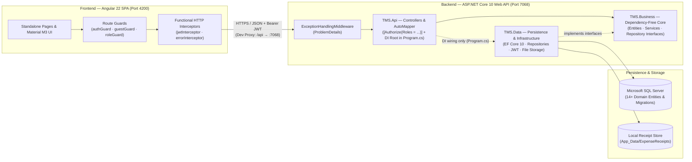
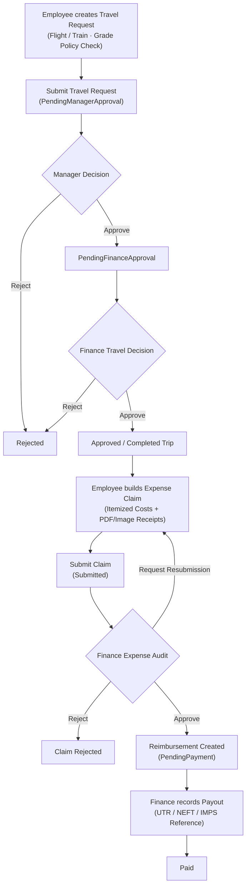

<div align="center">

# ✈️ Travel Management System (TMS)

**An enterprise-grade, role-based Corporate Travel, Expense Audit & Reimbursement Platform**

[](https://dotnet.microsoft.com/)
[](https://learn.microsoft.com/aspnet/core/)
[](https://angular.dev/)
[](https://material.angular.dev/)
[](https://www.typescriptlang.org/)
[](https://learn.microsoft.com/ef/core/)


*Built with a **3-Layer Architecture using Dependency Inversion** on **ASP.NET Core 10** and a signal-driven **Angular 22 + Material M3** client, featuring multi-tier approvals, grade-based travel policy checks, in-app receipt auditing, and reimbursement workflows.*

</div>

---

## 📋 Overview

**Travel Management System (TMS)** digitizes the complete lifecycle of corporate business travel — from initial trip planning and automated grade-policy checks to multi-tier approvals, itemized daily expense claims, receipt verification, and finance payout settlement.

It is engineered as a production-style full-stack application with strict separation of concerns, role-based access control across **4 organizational personas**, optimistic concurrency protection on approvals, and a responsive Material 3 interface localized for Indian enterprises.

---

## ✨ Engineering Highlights

- **3-Layer Architecture with Dependency Inversion (`TMS.Api` → `TMS.Business` ← `TMS.Data`):** `TMS.Business` has **zero project or NuGet dependencies** and owns all domain entities, models, business services, and repository/storage interfaces. `TMS.Data` depends inward on `TMS.Business` to implement EF Core 10 repositories, JWT/refresh token services, password hashing, and receipt storage; `TMS.Api` controllers depend only on `TMS.Business`, referencing `TMS.Data` solely inside `Program.cs` as the DI composition root.
- **Stateless Auth + Refresh Token Rotation:** Short-lived JWT Bearer access tokens paired with database-persisted refresh token rotation, `PasswordHasher<User>` credential security, and silent refresh handling in Angular's functional `jwtInterceptor`.
- **Multi-Tier Approval & Optimistic Concurrency:** Sequential **Manager → Finance** approval pipeline protected by EF Core `RowVersion` concurrency tokens on `TravelApproval` and centralized `ProblemDetails` (`409 Conflict`, `400`, `401`, `404`) exception handling.
- **Policy-Aware Travel Planning:** Evaluates trip requests against employee-grade travel policies (Flight/Train tiers and limits) and records `TravelRequestPolicyViolations` for transparent reviewer visibility.
- **Zero-Friction In-App Receipt Auditing:** Finance reviewers and employees preview uploaded **PDFs (`<iframe>`) and images** directly inside an Angular Material modal backed by `Blob` object URLs with automatic memory cleanup (`URL.revokeObjectURL`) — no forced file downloads.
- **Modern Angular 22 Frontend:** 100% standalone components, Angular Signals, lazy-loaded feature routes, functional `authGuard` / `guestGuard` / `roleGuard`, and Material M3 theming.

---

## 🏛️ System Architecture



---

## 🔄 End-to-End Business Workflow



---

## 👥 Role-Based Capabilities

| Role | Route Scope | Core Capabilities |
|---|---|---|
| **Employee** | `/travel-requests`, `/my-trips`, `/expense-claims`, `/reimbursements` | Create, edit, submit, and cancel travel requests; view policy violation flags; build itemized daily expense claims; upload & preview receipts in-app; resubmit claims when requested; track reimbursement payouts. |
| **Manager** | `/manager/approvals` *(+ Employee self-service routes)* | Review department travel requests in an approval queue; approve or reject with review comments; inspect historical approval decisions alongside personal trip management. |
| **Finance** | `/finance/approvals`, `/finance/expense-reviews`, `/finance/reimbursements` | Perform tier-2 travel request approvals; audit submitted expense claims and inspect receipts in-app; approve, reject, or request claim resubmission; settle approved claims by recording payout transaction references (UTR / NEFT / IMPS). |
| **Admin** | `/admin/employees` | Manage employee directory and lifecycle; assign departments, employee grades, and RBAC roles (`Employee`, `Manager`, `Finance`, `Admin`). |

---

## 🛠️ Tech Stack

### Backend
| Technology | Purpose |
|---|---|
| **ASP.NET Core 10 (`net10.0`)** | RESTful Web API, DI container, middleware pipeline |
| **Entity Framework Core 10 + SQL Server** | Code-first ORM, relational modeling, migrations, `RowVersion` concurrency |
| **JWT Bearer + Refresh Tokens** | Role-based authentication & token rotation |
| **ASP.NET Core Identity PasswordHasher** | Salted PBKDF2 password hashing |
| **AutoMapper 17** | Clean DTO ↔ Command/Entity mapping |
| **OpenAPI + Scalar (`Scalar.AspNetCore`)** | Interactive API documentation at `/scalar/v1` with Bearer auth |

### Frontend
| Technology | Purpose |
|---|---|
| **Angular 22** | Standalone components, Signals, `@angular/router` lazy loading |
| **Angular Material M3 + CDK 22** | Enterprise UI components, dialogs, responsive shell, M3 tokens |
| **TypeScript 6** | Strict end-to-end static typing across models, services & guards |
| **Vitest 4 + JSDOM** | Fast unit & component test runner (**31 test files, 60 tests**) |
| **`@angular/common/locales/en-IN`** | Indian Rupee (`₹` / `INR`) & `en-IN` number/date formatting |

---

## 📁 Project Structure

```text
Travel-Management-System/
├── Backend/
│   └── TMS.Api/
│       ├── TMS.Api/                  # Controllers, DTOs, AutoMapper Profiles, Exception Middleware, Program.cs
│       ├── TMS.Business/             # Domain Entities, Service Interfaces & Business Logic, Models
│       └── TMS.Data/                 # ApplicationDbContext, EF Core Migrations, Repositories, JWT & Storage Services
└── Frontend/
    └── TMS.Client/
        ├── proxy.conf.json           # Proxies /api/* requests to https://localhost:7068 in development
        └── src/app/
            ├── core/                 # AuthService, auth/guest/role guards, JWT & error interceptors
            ├── features/             # Lazy-loaded pages (Dashboard, Travel Requests, My Trips, Expense Claims,
            │                         # Reimbursements, Manager Approvals, Finance Reviews & Payouts, Admin)
            ├── layout/               # Responsive AppShell, Sidebar, TopToolbar, AuthLayout, role-based nav config
            └── shared/               # Status chips, ReceiptViewerDialog (PDF/Image), Approval dialogs, utilities
```

---

## 🔌 API Surface Overview

All endpoints are secured with JWT Bearer authentication (except `/api/auth/*`) and documented interactively via **Scalar** in development at `https://localhost:7068/scalar/v1`.

| Controller | Base Route | Authorized Roles | Responsibility |
|---|---|---|---|
| `AuthController` | `/api/auth` | Anonymous | Login, refresh token rotation, logout |
| `TravelRequestsController` | `/api/travelrequests` | `Employee, Manager` | Create, update, list, submit, cancel travel requests |
| `ManagerApprovalsController` | `/api/manager/approvals` | `Manager` | Pending team queue, approve/reject, decision history |
| `FinanceApprovalsController` | `/api/finance/approvals` | `Finance` | Tier-2 travel approvals queue & decisions |
| `ExpenseClaimsController` | `/api/trips/{travelRequestId}/expense-claim` | `Employee, Manager` | Expense claim items, receipt upload/download, submit |
| `FinanceExpenseClaimsController` | `/api/finance/expense-claims` | `Finance` | Audit claims, preview receipts, approve / reject / request resubmission |
| `EmployeeReimbursementsController` | `/api/reimbursements` | `Employee, Manager` | Track personal reimbursement status & payment references |
| `FinanceReimbursementsController` | `/api/finance/reimbursements` | `Finance` | Pending payout queue & record UTR/NEFT payment |
| `EmployeesController` | `/api/employees` | `Admin` | Employee creation, updates, listing, role/grade assignment |
| `RolesController` | `/api/roles` | `Admin` | Query available system roles |

---

## 🚀 Getting Started (Local Development)

### Prerequisites
- [.NET 10 SDK](https://dotnet.microsoft.com/download/dotnet/10.0)
- [Node.js 20+](https://nodejs.org/) & npm
- Microsoft SQL Server (LocalDB, Developer, Express, or container instance)

### 1. Clone the Repository
```bash
git clone https://github.com/nixRoodra/Travel-Management-System.git
cd Travel-Management-System
```

### 2. Configure & Run the Backend API
1. Update the database connection string (`ConnectionStrings:DefaultConnection`) and JWT signing key (`Jwt:Key`, minimum 32 bytes) in `Backend/TMS.Api/TMS.Api/appsettings.Development.json` (or via `dotnet user-secrets`).
2. Apply Entity Framework Core migrations to create the schema:
   ```bash
   cd Backend/TMS.Api
   dotnet ef database update --project TMS.Data --startup-project TMS.Api
   ```
3. Launch the API with the HTTPS profile:
   ```bash
   cd TMS.Api
   dotnet run --launch-profile https
   ```
   - **API Base URL:** `https://localhost:7068` (HTTP fallback: `http://localhost:5110`)
   - **Interactive API Docs (Scalar):** `https://localhost:7068/scalar/v1`

### 3. Run the Angular Frontend
In a separate terminal:
```bash
cd Frontend/TMS.Client
npm install
npm start
```
- **Web App:** `http://localhost:4200`
- Development API calls to `/api/*` are automatically forwarded to `https://localhost:7068` via `proxy.conf.json`.

---

## 🧪 Verification & Testing

```bash
# Run Frontend unit & component tests (Vitest — 31 test files, 60 tests)
cd Frontend/TMS.Client
npm test -- --watch=false

# Type-check Frontend TypeScript
npx tsc --noEmit

# Build & verify Backend solution (.NET 10)
cd Backend/TMS.Api
dotnet build
```

---

## 📬 Contact

Built by **[@nixRoodra](https://github.com/nixRoodra)** — feel free to connect or explore the codebase!
